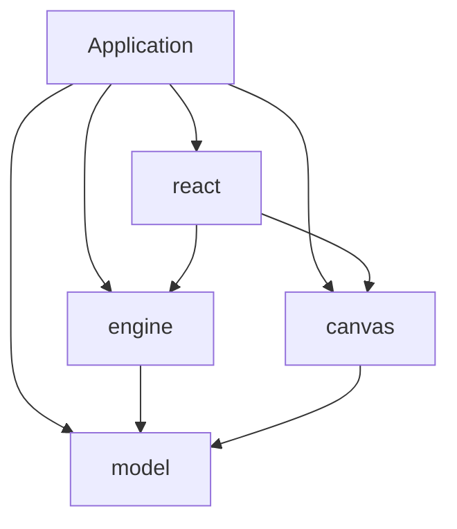

# Architecture

English | [简体中文](architecture.zh-CN.md)

The system separates graph data, workflow execution, the canvas, and React integration. The application connects these layers: for example, it reads the canvas graph, passes it to the engine, and displays execution results on the canvas.

## Module responsibilities

| Module | Responsibility |
| --- | --- |
| model | Define nodes, ports, variables, and graph JSON without external dependencies |
| engine | Execute graph nodes and manage events, tasks, loops, and node resources without depending on the DOM |
| canvas | Edit and display graphs and execution results using JointJS and lit-html, without depending on engine |
| react | Provide Providers and `GraphView` to connect React components with the canvas and engine |
| Application | Register business nodes, save files, and connect engine events to the UI |

Arrows indicate dependencies:

The canvas and engine need the same node and graph data, but workflow execution does not need a page. Keeping shared definitions in model allows the engine and editor to be used independently. Packages import through public entry points and preserve references to lower layers using `external` during bundling, avoiding duplicate copies of the same node classes.

## Terminology

| Term | Meaning |
| --- | --- |
| Node definition `Node` | Ports, execution logic, and resource management methods for a node type |
| Node instance `NodeInstance` | A specific node in a graph with its own id and configuration; editing and execution use separate instances |
| Graph definition `JsonGraph` | JSON data for nodes, links, variables, embedded subgraphs, and the viewport |
| Execution ports and data ports | `exec` determines which node runs next; data ports carry values. Each uses separate connections |
| Workflow session | The period from startup to stop, during which events can continue to arrive |
| Execution task | Work created by the initial execution or a business event, identified by `taskId` |
| Loop invocation | One complete invocation of a `Loop`, identified by `invocationId` |
| Loop frame | An independent set of data for one loop iteration, identified by `frameId` |
| Subgraph file and embedded subgraph | The application saves the former separately; the latter lives in its owning graph's subgraphs |
| Undo and history replay | Undo restores editing operations; replay displays the graph and data from a past execution |

## Data ownership

| Data | Ownership rules |
| --- | --- |
| Graph configuration | model defines the format, canvas edits it, and the application saves it; execution logs and temporary state stay separate |
| Session resources | engine manages connections, listeners, and `nodeState`; resources initialize once per session and are cleaned up on stop |
| Task data | Each task owns its inputs, outputs, variables, and temporary `state`; cancelling one task does not affect others |
| Iteration data | Inputs, outputs, and temporary state are recreated for each iteration; business state passes between iterations through return nodes |
| Canvas execution indicators | canvas displays states and data supplied by the application; it neither executes workflows nor collects logs |
| Saved files | The application saves current edits before switching files and pauses autosave while displaying history |

Event arguments and task data are copied to isolate them. Resources that cannot be copied, such as connections and functions, belong in services or `nodeState`. See the [engine README](../packages/primflow-engine/README.md) for usage.

## Execution flow

1. The user edits the canvas, and the application saves the current file after a delay.
2. When execution starts, the application reads the canvas JSON and loads referenced standalone subgraph files.
3. The application passes the complete graph to engine and calls `process`.
4. engine executes nodes and emits events; the application updates canvas states, logs, and the execution chain.
5. History is available after stopping. Leaving replay restores the original editing graph.

engine only receives prepared graphs and does not read browser files. Ordinary subgraphs use `Start` / `End` to receive parameters and return results; see [Subgraph parameters](../packages/primflow-engine/docs/subgraphs.md). Loops use `LoopEntry` / `LoopReturn`; see [Loop execution](../packages/primflow-engine/docs/loops.md). Their execution rules differ.

## Errors and stopping

- The application blocks startup for missing subgraph files or circular file references; the engine rejects invalid loop structures during loading.
- After task cancellation or loop completion, invalidated callbacks cannot write results or execute downstream nodes.
- A session keeps accepting events after the initial task finishes. Calling stop ends the session and cleans up resources.
- A breakpoint pauses only its task. `resume(taskId)` resumes that task, and `stopTask(taskId)` cancels it.
- Stopping cannot forcibly terminate arbitrary business code. Nodes should respond to cancellation signals. External operations already performed are not rolled back.

The engine, tasks, and nodes each have their own states. See the [engine README](../packages/primflow-engine/README.md) for complete state lists.

## What to check when changing code

| Change | Related checks |
| --- | --- |
| Node ports or JSON format | model definitions, canvas serialization, engine loading, and example file restoration |
| Task queries or events | engine and the example's events.ts |
| Canvas mounting API | canvas, React `GraphView`, and [React integration](../packages/primflow-react/docs/adapter-contract.md) |
| Package dependencies or build configuration | Run `pnpm build` and the [boundary checks](../scripts/verify-boundaries.mjs) |

Related tests cover [task isolation](../packages/primflow-engine/tests/tasks.test.ts), [loops](../packages/primflow-engine/tests/loops.test.ts), [subgraph files](../examples/primflow-react/tests/subgraphs.test.ts), [replay](../packages/primflow-canvas/tests/replay.test.ts), and [autosave](../examples/primflow-react/tests/autosave.test.ts).
