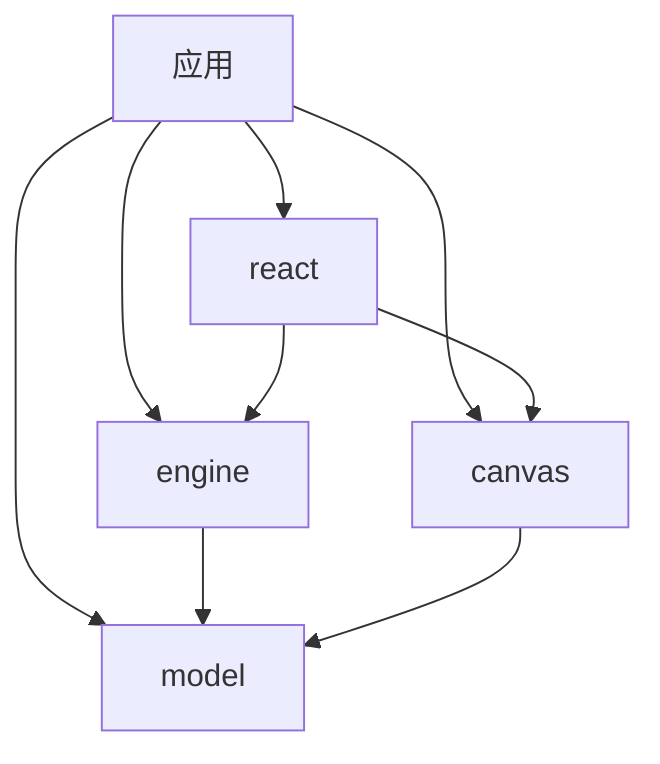

# 架构说明

[English](architecture.md) | 简体中文

系统把图数据、执行流程、画布和 React 接入分开。应用负责把它们连接起来，例如读取画布内容交给引擎执行，再把执行结果显示到画布。

## 模块分工

| 模块 | 负责什么 |
| --- | --- |
| model | 定义节点、端口、变量和图的 JSON 格式，不依赖外部库 |
| engine | 按图执行节点，管理事件、任务、循环和节点资源，不依赖 DOM |
| canvas | 使用 JointJS、lit-html 和 CodeMirror 编辑、显示图及执行结果，不依赖 engine |
| react | 提供 Provider 和 `GraphView`，连接 React 组件与画布、引擎 |
| 应用 | 注册业务节点、保存文件，连接引擎事件和界面 |

箭头表示依赖关系：

这样拆分是因为画布和引擎需要相同的节点与图数据，但执行工作流不需要页面；把公共定义放在 model 后，引擎和编辑器可以各自单独使用。包之间从公开入口导入，构建时用 `external` 保留对下层库的引用，避免把同一份节点类打包两次。

## 常用概念

| 概念 | 含义 |
| --- | --- |
| 节点定义 `Node` | 一种节点的端口、执行逻辑和资源管理方法 |
| 节点实例 `NodeInstance` | 图中的一个具体节点，有自己的 id 和配置；编辑和执行使用不同实例 |
| 图定义 `JsonGraph` | 节点、连线、变量、内嵌子图和视口的 JSON 数据 |
| 执行端口与数据端口 | `exec` 决定下一步执行哪个节点，数据端口传递值；两种连线分别建立 |
| 工作流会话 | 从启动到停止的一段运行过程，期间可以持续接收事件 |
| 执行任务 | 首次执行或一次业务事件产生的工作，用 `taskId` 区分 |
| 循环调用 | 进入一次 `Loop` 的完整过程，用 `invocationId` 区分 |
| 循环帧 | 引擎为单轮循环保存的一组独立数据，用 `frameId` 区分 |
| 子图文件与内嵌子图 | 前者由应用单独保存，后者存放在所属图的 subgraphs 中 |
| 撤销与历史回溯 | 撤销恢复编辑操作；回溯查看某次执行时的图和数据 |

## 数据由谁管理

| 数据 | 管理规则 |
| --- | --- |
| 图配置 | model 定义格式，canvas 编辑，应用保存；不混入执行日志或临时状态 |
| 引擎注册信息 | 应用提供 `NodeRegistry`，各引擎持有自己的执行器和服务注册，供本引擎的任务复用 |
| 会话资源 | engine 管理连接、监听和 `nodeState`；每次会话初始化一次，停止时清理 |
| 任务数据 | 每个任务独立保存输入、输出、应用上下文和临时 `taskState`，取消一个任务不影响其他任务 |
| 任务业务状态 | 每个任务独立持有 `ctx.state` 的已提交 JSON 值，每次节点执行读取一个版本并暂存自己的更新 |
| 单轮循环数据 | 每轮重新创建输入、输出和临时状态；循环返回节点传递下一轮的入口值 |
| 画布执行提示 | canvas 显示应用传入的状态和数据，不负责执行或收集日志 |
| 文件存档 | 应用切换文件前先保存当前修改，查看历史记录时暂停自动保存 |

事件参数和任务数据通过复制来隔离。连接、函数等不能复制的资源放在服务或 `nodeState` 中，具体用法见 [engine README](../packages/primflow-engine/README.zh-CN.md)。

类型注册表和类型规则由 model 管理。图文件保存类型 ID 和可序列化的值。文件字节由宿主服务管理，实时进度和流队列由引擎按次执行管理。应用订阅进度事件并将预览交给画布。

## 一次执行的过程

1. 使用者编辑画布，应用延迟保存当前文件。
2. 点击执行时，应用读取画布 JSON，并加载其中引用的独立子图文件。
3. 应用通过 `engine.loadGraph()` 加载并校验完整的图，再调用 `engine.start()`。
4. engine 执行节点并记录[任务执行日志](../packages/primflow-engine/docs/execution-trace.zh-CN.md)。应用可以订阅事件来实时更新画布状态。
5. 停止后可以查看历史记录；退出历史回溯时恢复原来的编辑图。

engine 只接收已经准备好的图，不读取浏览器文件。普通子图通过 `Start` / `End` 传入参数和返回结果，规则见 [子图参数](../packages/primflow-engine/docs/subgraphs.zh-CN.md)；循环使用 `LoopEntry` / `LoopReturn`，见 [循环执行](../packages/primflow-engine/docs/loops.zh-CN.md)。两者的执行规则不同。

## 出错和停止时

- 子图文件缺失或相互循环引用时，应用阻止启动；循环结构非法时，引擎拒绝加载。
- 取消任务或结束循环后，已经失效的回调不能再写入结果或执行后续节点。
- 首次任务完成后，会话仍可接收事件；调用 stop 才停止整个会话并清理资源。
- 断点只暂停对应任务；`resume(taskId)` 继续该任务，`stopTask(taskId)` 取消该任务。
- 停止无法强行终止任意业务代码，节点应响应取消信号。已经发生的外部操作不会回滚。

引擎、任务和节点分别有自己的状态，完整状态列表见 [engine README](../packages/primflow-engine/README.zh-CN.md)。

## 修改代码时检查哪里

| 修改内容 | 需要一起检查 |
| --- | --- |
| 节点端口或 JSON 格式 | model 定义、canvas 保存加载、engine 加载、示例文件恢复 |
| 任务查询或事件 | engine 与示例的 events.ts |
| 画布挂载接口 | canvas、React `GraphView` 和 [React 接入](../packages/primflow-react/docs/adapter-contract.zh-CN.md) |
| 包依赖或构建配置 | 运行 `pnpm build`，执行 [依赖检查](../scripts/verify-boundaries.mjs) |

相关测试包括 [任务隔离](../packages/primflow-engine/tests/tasks.test.ts)、[循环](../packages/primflow-engine/tests/loops.test.ts)、[子图文件](../examples/primflow-react/tests/subgraphs.test.ts)、[回溯](../packages/primflow-canvas/tests/replay.test.ts)和[自动保存](../examples/primflow-react/tests/autosave.test.ts)。
